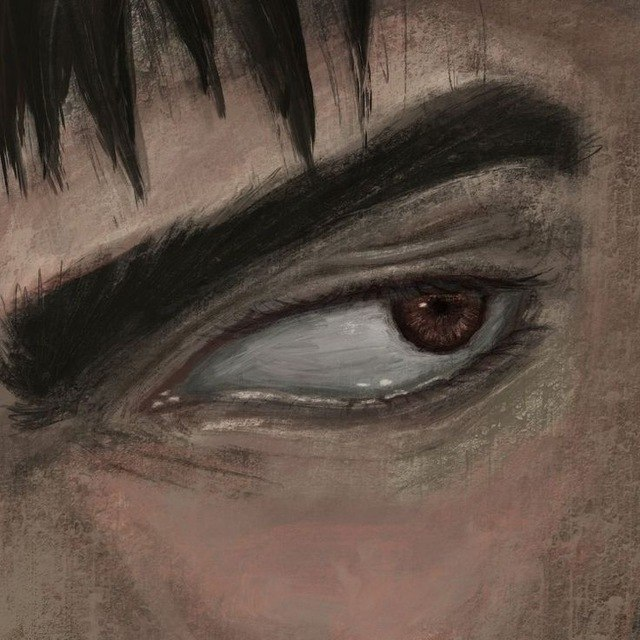
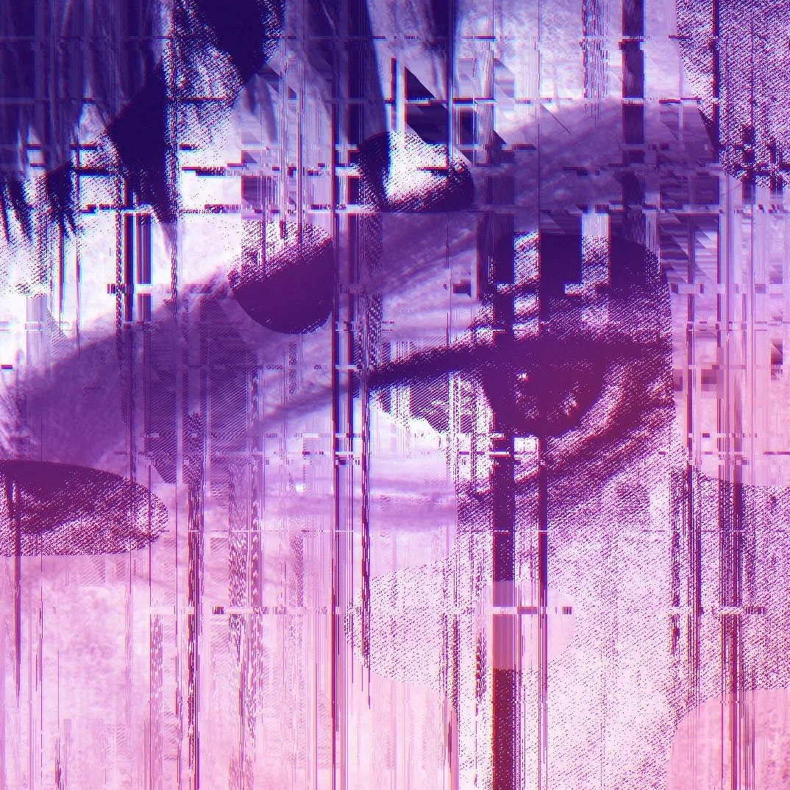

# glitchcore

Скрипт, который превращает рисунок (манга, аниме-арт) в глитчкор: весь кадр забивается шумом — штрихи, пиксельные блоки, вертикальные потёки, чёрные провалы, красно-фиолетовые акценты. Исходный рисунок при этом остаётся читаемым.

Один файл, из зависимостей только Pillow и numpy.
## Сравнение

<table>
  <tr>
    <th>Оригинал</th>
    <th>Результат</th>
  </tr>
  <tr>
    <td></td>
    <td></td>
  </tr>
</table>

## Установка

```bash
git clone <ссылка-на-репозиторий>
cd glitchcore
pip install -r requirements.txt
```

Нужен Python 3. Опционально можно поставить `scipy` (ускоряет поиск фона в режиме `--tones`) и `opencv-python` (нужен только для `--bg grabcut`). Без них всё остальное работает.

## Быстрый старт

```bash
python glitchcore.py
```

Откроется окно выбора картинки, потом окно выбора папки для результата. Если окна недоступны (сервер, голая консоль), пути спросят в терминале.

Можно сразу указать файл:

```bash
python glitchcore.py картинка.jpg
```

Результат сохранится рядом с исходником. Файл можно просто перетащить в окно терминала.

## Режимы

| Режим | Когда использовать | Команда |
|---|---|---|
| обычный | чистая линейная графика: чёрные линии на белом (манга) | `python glitchcore.py картинка.jpg` |
| `--tones` | цветные и залитые рисунки, где важны тона и лицо | `python glitchcore.py картинка.jpg --tones` |

**Обычный режим.** Линии рисунка становятся белыми на чёрном фоне, вокруг фигуры идёт тонкая обводка и цветные «призраки» (красный и синий/фиолетовый сдвиг). Весь фон заполняется шумом, собранным из самого арта.

**Режим `--tones`.** Скрипт находит фон (см. раздел «Поиск фона») и заменяет его шумом. Персонаж остаётся с родными тонами, поверх него ложатся глитчи: сдвиги полос, пиксельные блоки и цветные плашки. Обводка по умолчанию выключена (вернуть: `--outline`).

Если в обычном режиме результат получился «плоским» (персонаж превратился в белое пятно или шума почти нет), попробуй `--tones`. Если исходник со светлыми линиями на тёмном фоне, добавь `--invert`.

## Стиль `stretch` (растяжка пикселей)

Второй стиль, не шум из штрихов, а растянутая картинка: тонкие вертикальные потёки, диагональные протяжки, штриховка, пиксельные блоки и цветная кайма на светлом фоне. Силуэт персонажа остаётся читаемым, потёки только добавляются поверх него.

```bash
python glitchcore.py картинка.jpg --style stretch
python glitchcore.py картинка.jpg --style stretch --amount 1.2 --preset violet
```

`--amount` задаёт силу эффекта: `0.3` слабо, `0.7` нормально (по умолчанию), `1.0` и выше жёстко, но фигура всё равно видна. Лучше всего работает на светлом фоне. Цвет выбирается через `--preset` (`red`, `violet`, `ice`, `acid`).

## Параметры

| Параметр | По умолчанию | Что делает |
|---|---|---|
| `input` | — | путь к картинке. Если не указан, откроется окно выбора |
| `-o`, `--out` | рядом с исходником | папка для результата (или путь к `.png`, если `-n 1`) |
| `-n`, `--variants` | `1` | сколько разных вариантов сделать |
| `--preset` | `red` | цветовая схема: `red`, `violet`, `ice`, `acid` |
| `--ink` | из пресета | свой цвет шумовых линий, `#rrggbb` |
| `--accent1` | из пресета | первый акцентный цвет, `#rrggbb` |
| `--accent2` | из пресета | второй акцентный цвет, `#rrggbb` |
| `--seed` | случайный | seed. Один и тот же seed с теми же параметрами даёт тот же результат |
| `--size` | `1080` | длинная сторона результата в пикселях |
| `--density` | `1.0` | плотность шума. Больше значит больше штрихов и блоков |
| `--voids` | `0.44` | чёрные провалы. Больше значит больше чёрного, меньше значит меньше |
| `--invert` | выкл. | для светлых линий на тёмном фоне |
| `--style` | `noise` | `noise` (весь кадр в шум) или `stretch` (растяжка пикселей) |
| `--amount` | `0.7` | сила эффекта в стиле `stretch` |
| `--tones` | выкл. | режим для цветных и залитых рисунков |
| `--outline` | выкл. | вернуть цветную обводку вокруг персонажа (только с `--tones`) |
| `--bg` | `auto` | как искать фон в `--tones`: `auto`/`color`, `light`, `grabcut` |
| `--bg-tol` | `20` | насколько цвет может отличаться от краёв кадра, чтобы считаться фоном. Больше значит больше фона |
| `--rect` | — | где персонаж: `x0,y0,x1,y1` от 0 до 1. Всё вне прямоугольника станет шумом |
| `--mask` | — | своя маска (png/jpg): белое — персонаж, чёрное — шум. Заменяет автопоиск |
| `--show-mask` | выкл. | сохранить маску рядом с результатом, чтобы посмотреть, что скрипт принял за фон |
| `--no-gui` | выкл. | не открывать окна, спрашивать пути в консоли |

Полный список: `python glitchcore.py -h`.

## Примеры

```bash
# 4 разных варианта в фиолетовой схеме, в папку out
python glitchcore.py картинка.jpg -o out -n 4 --preset violet

# цветной арт, фон в шум, персонаж с родными тонами
python glitchcore.py арт.png --tones --preset red

# повторить понравившийся результат (seed есть в имени файла)
python glitchcore.py картинка.jpg --seed 42 --preset red

# свои цвета
python glitchcore.py картинка.jpg --ink "#ffffff" --accent1 "#ff0033" --accent2 "#6a4cff"

# больше шума и больше чёрного
python glitchcore.py картинка.jpg --density 1.5 --voids 0.5

# без окон, пути вводятся в терминале
python glitchcore.py --no-gui
```

## Поиск фона (`--tones`)

По умолчанию фон определяется по цвету: скрипт смотрит, какие цвета занимают края кадра, и считает фоном всё, что похоже на них по цвету и связано с краем. Поэтому работает и на светлом фоне, и на тёмном, и на цветном.

Что делать, если фон найден неправильно (сначала добавь `--show-mask`: в маске белое — персонаж, чёрное — то, что станет шумом):

- **Часть фона осталась нетронутой** (например, забор, похожий по цвету на персонажа). Укажи, где персонаж, через `--rect`: например, `--rect 0.25,0,1,1` оставит персонажа в правых трёх четвертях кадра, а всё левее станет шумом.
- **Фон съел часть персонажа** (тёмные волосы на тёмном фоне). Уменьши `--bg-tol`, например до `14`. Если уменьшить слишком сильно, фон может перестать находиться совсем.
- **Фона нашлось мало.** Увеличь `--bg-tol`, например до `30`.
- **Сложный фон, похожий на персонажа.** Попробуй `--bg grabcut` (нужен `pip install opencv-python`). Его можно сочетать с `--rect`.
- **Ничего не помогает.** Нарисуй маску сам в любом редакторе (персонаж белым, остальное чёрным) и передай через `--mask маска.png`.
- **Старое поведение**, когда фоном считалось только светлое: `--bg light`.

## Что получается на выходе

Файлы сохраняются в PNG с именем `<имя>_glitch_<пресет>_<seed>.png`, например `picture_glitch_violet_42.png`. Seed напечатается в консоли и есть в имени файла, так что любой вариант можно воспроизвести.

Если картинка не квадратная, пропорции сохраняются. Прозрачный PNG обрабатывается так, будто фон белый.

## Как это работает

1. Картинка переводится в оттенки серого и превращается в карту «чернил» (тёмное = линия).
2. Из этой карты вырезаются случайные куски, увеличиваются, поворачиваются, и из них берутся только контуры. Получаются тонкие штрихи, которыми заполняется весь кадр.
3. Слои штрихов обрабатываются глитчами: мозаика из крупных пикселей, вертикальные и горизонтальные потёки, сортировка пикселей по столбцам, диагональные сдвиги.
4. Белый, красный и фиолетовый слои складываются на чёрном фоне. Поверх идут чёрные провалы, зерно и линии развёртки.
5. Исходная фигура со слегка сдвинутыми полосами кладётся поверх шума.

## Проблемы

- **`No module named tkinter` или не открывается окно выбора файла.** Запускай с `--no-gui`, пути будут вводиться в терминале. В Linux окно можно вернуть командой `sudo apt install python3-tk`.
- **Долго считается на большой картинке.** Уменьши `--size`, например до `720`.
- **Фон не заменился шумом или заменился не весь в режиме `--tones`.** См. раздел «Поиск фона» выше. Если персонаж упирается в край кадра цветом, похожим на фон, автопоиск может принять его за фон, тогда помогут `--rect` или `--mask`.


